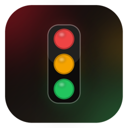
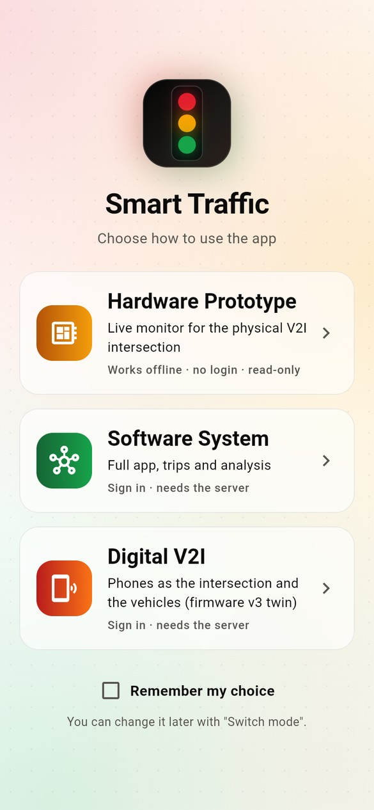
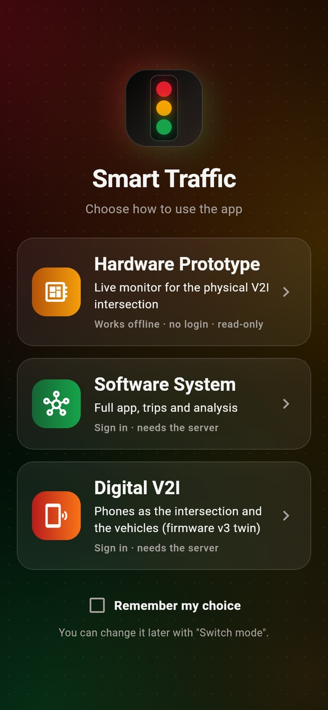
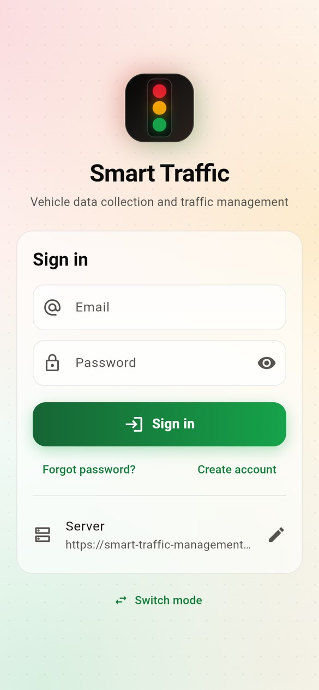
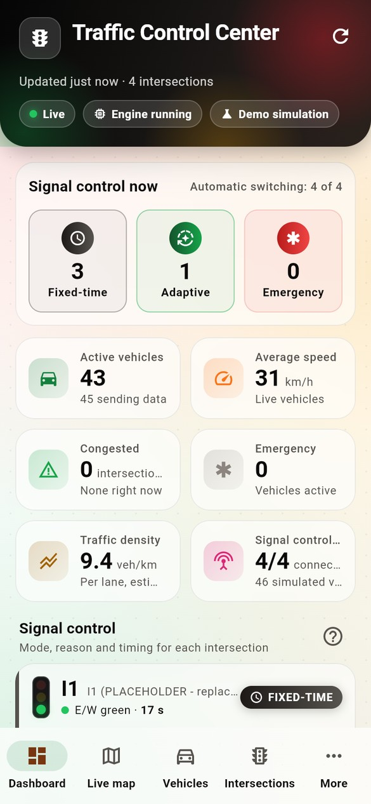
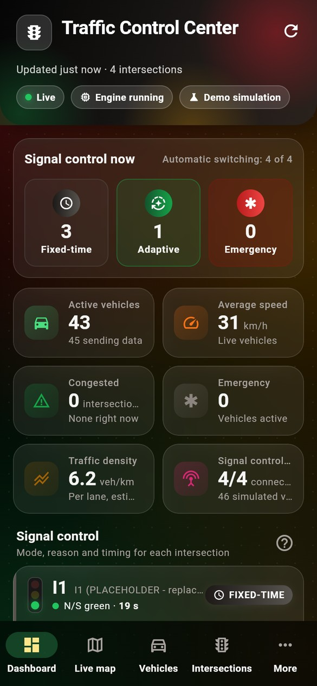
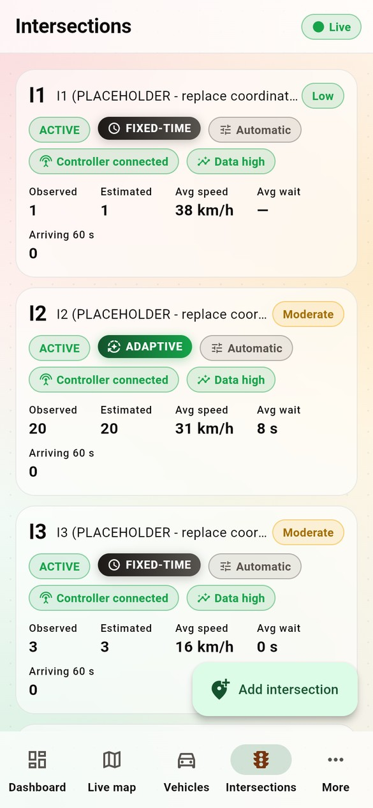
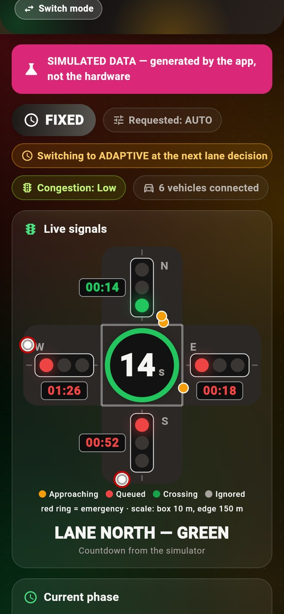
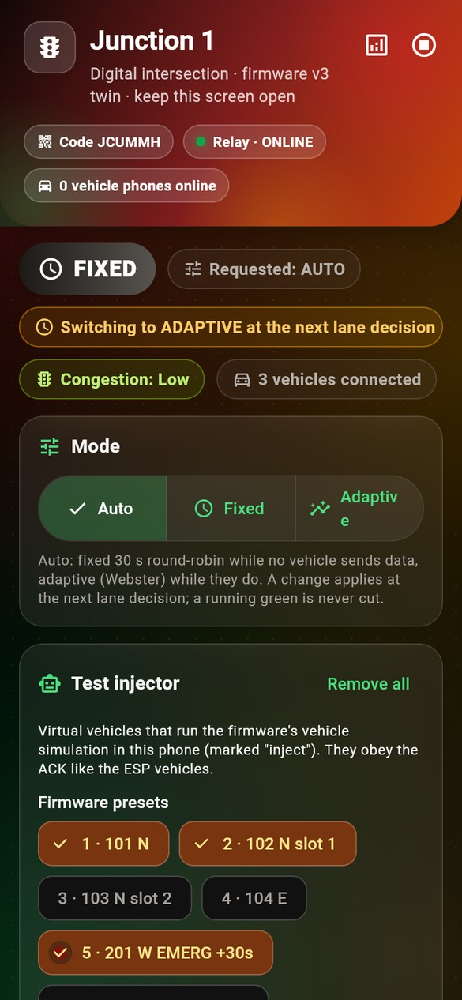
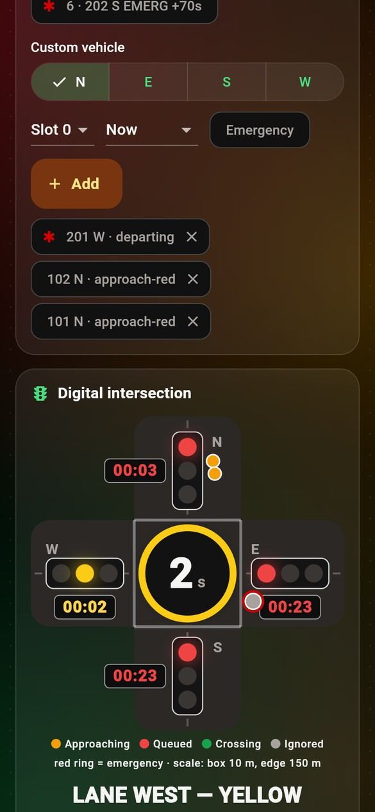

# Smart Traffic Management System

<p align="center"></p>

Final-year project: smartphone vehicle telemetry feeding a multi-intersection adaptive traffic
management engine, with a driver app, a traffic-manager dashboard, SUMO simulation and a demo mode.

- **Three modes, chosen when the app starts:** **Hardware Prototype**, a read-only offline monitor
  for the physical ESP32 intersection (no login, see `docs/HARDWARE_MODE.md`); **Digital V2I**, a
  digital twin of the V2I firmware v3 where one phone is the intersection and other phones are
  vehicles, over the server's relay or a local Wi-Fi / hotspot (see `docs/DIGITAL_V2I.md`); and
  **Software System**, the full app below.
- **Driver / vehicle app (Android):** register a vehicle, get a Vehicle ID, start/stop GPS tracking with
  an offline queue, trip history, and emergency mode for authorized emergency vehicles.
- **Manager app (Android and web):** a traffic control centre dashboard that shows each
  intersection's signal mode: fixed-time by default, switched automatically to adaptive timing when
  congestion is significant. Each status gives the reason, the traffic behind it and the calculated
  green/yellow/red against the fixed plan. The live map shows the signal lights at every
  intersection. Also: vehicles, intersections with observed / calculated / estimated traffic
  metrics, traffic analysis, emergency authorizations and events, signal plans, mode-change history,
  and demo simulation controls including a simulated rush hour.
- **Backend:** FastAPI + PostgreSQL. Server-side validation of every packet, roles, emergency
  authorization, a traffic engine that runs every 2 s, a WebSocket feed for dashboards, and an API for
  machine clients (SUMO bridge, Raspberry Pi controllers).

Signal timings produced by the engine are **advisory and for simulation/prototype use**. Simulated
data (demo fleet, SUMO) is always labelled as such and kept separate from real vehicles.

## Live server

The backend runs on Render: **<https://smart-traffic-management-app.onrender.com>**

| | |
|---|---|
| Health check | <https://smart-traffic-management-app.onrender.com/api/v1/health> (`"status":"ok"`, `"database":"ok"`) |
| API docs | <https://smart-traffic-management-app.onrender.com/docs> |
| Android app | [latest release](https://github.com/SAAD-2113/Smart-Traffic-Management-App/releases/latest) (APK) |

The app is preset to this server: install the APK, then sign in or tap **Create account**. It runs on
Render's free plan: the **Keep Render awake** workflow pings it every 10 minutes, but after a pause
the first request can still take up to a minute. The free database expires after about 30 days
(see `docs/DEPLOY_CLOUD.md`).

## Screenshots

<table>
  <tr>
    <td align="center"><br><sub>Mode selection (light)</sub></td>
    <td align="center"><br><sub>Mode selection (dark)</sub></td>
    <td align="center"><br><sub>Sign in, hosted server preset</sub></td>
  </tr>
  <tr>
    <td align="center"><br><sub>Manager dashboard (light)</sub></td>
    <td align="center"><br><sub>Manager dashboard (dark)</sub></td>
    <td align="center"><br><sub>Intersections: I2 adaptive in a rush hour</sub></td>
  </tr>
  <tr>
    <td align="center"><br><sub>Hardware mode (simulator)</sub></td>
    <td align="center"><br><sub>Digital V2I: intersection phone</sub></td>
    <td align="center"><br><sub>Digital V2I: live junction</sub></td>
  </tr>
</table>

Taken from the app's web build at phone size, with the demo fleet (the manager screens show
simulated vehicles, labelled as such in the app) and the Digital V2I test injector.

| Folder | Contents | Status |
|---|---|---|
| `backend/` | FastAPI service: auth, roles, vehicles, devices, tracking, telemetry, emergency, intersections, traffic, signals, live WebSocket, demo, controller API | Phases 2-9 done |
| `traffic_engine/` | Pure-Python traffic analysis (mapping, metrics, data quality, network state), controllers (fixed, demand-proportional with coordination, emergency priority) and the demo fleet simulator | Done |
| `mobile/` | Flutter app: driver and manager roles in one app (Android APK + web dashboard); `mobile/packages/v2i_core`: pure-Dart port of the V2I firmware v3 used by Digital V2I and the Hardware-mode simulator | Done |
| `sumo_bridge/` | TraCI bridge between Eclipse SUMO and the backend, corridor generator | Done |
| `tools/` | `hardware_test_server.py`: imitates the ESP32 controller for testing Hardware mode | |
| `infra/` | Docker Compose for PostgreSQL (+PostGIS) | Done |
| `Dockerfile`, `render.yaml` | Server image and one-click Render deployment | Done |
| `docs/` | Architecture, API, security and privacy, testing, Windows setup, ADRs | |
| `dist/` | Android APK 1.2.0, and where to download the current APK (GitHub Releases) | |

## Start here

1. Use the [live server](#live-server), or run your own: **in the cloud** with `docs/DEPLOY_CLOUD.md`
   (no PC needed, phones connect from anywhere), or **on your PC** with `docs/SETUP_WINDOWS.md`
   (phones on the same Wi-Fi).
2. `docs/ARCHITECTURE.md`: system design, telemetry packet spec, traffic processing, emergency flow.
3. `docs/HARDWARE_MODE.md`: the ESP32 intersection monitor (Hardware mode), its simulator and test server.
   `docs/DIGITAL_V2I.md`: Digital V2I mode (phones as intersection and vehicles), metrics and exports.
4. `docs/API.md`, `docs/SECURITY_AND_PRIVACY.md`, `docs/TESTING.md`.

## Quick start (development)

```powershell
cd backend; copy .env.example .env      # set JWT_SECRET and DATABASE_URL (SQLite works for a demo)
uv sync; uv run alembic upgrade head
uv run python -m scripts.create_user --role MANAGER --email manager@example.com --name "Traffic Manager"
uv run python -m scripts.seed_intersections          # policy AUTO: fixed-time, adaptive when congested
uv run uvicorn app.main:app --host 0.0.0.0 --port 8000
```

Install the APK (from the repository's GitHub Releases, see `dist/README.md`; the older 1.2.0 files are in `dist/`) on an Android phone on the same Wi-Fi, tap **Server** on the
login screen and enter `http://<PC IP>:8000`. The app is preset to the hosted server,
`https://smart-traffic-management-app.onrender.com`; for another cloud server, enter its `https://` address instead.

## Tests

`traffic_engine`: 56 · `backend`: 134 · `mobile`: 99 · `mobile/packages/v2i_core`: 85 (see `docs/TESTING.md`).
